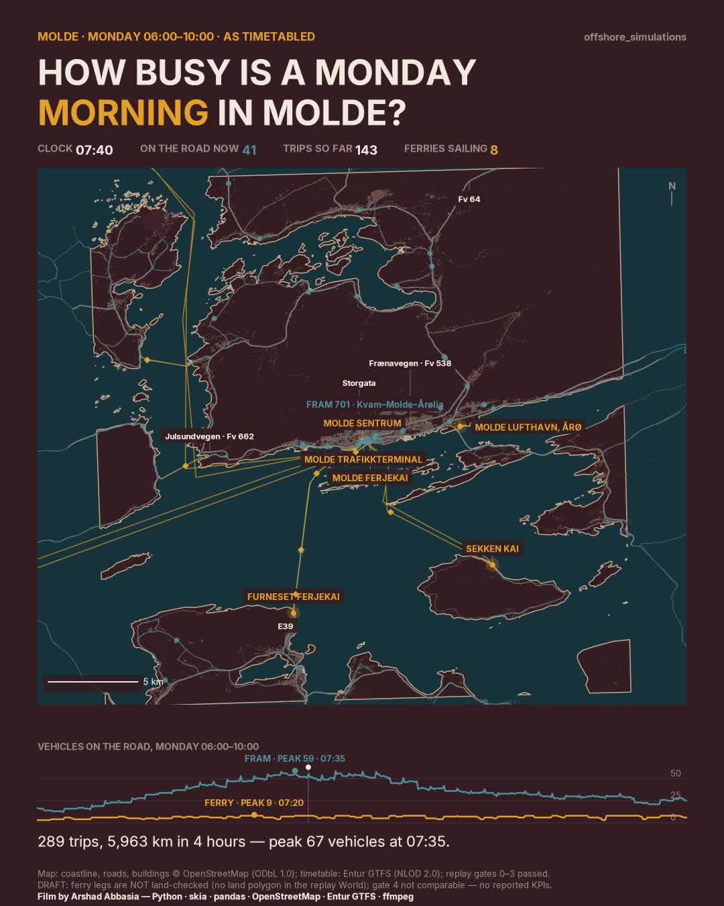

# How busy is a Monday morning in Molde?

A 24-second film made with this repository. [Watch it here](molde-morning-v2.mp4) (GitHub plays it in the browser).

## What it shows

One Monday, 06:00 to 10:00, as timetabled. 289 trips and 5,963 km in four hours, with a peak of 67 vehicles on the road at 07:35. One trip in five is a ferry, and the sea carries only 8 % of the distance.

## What it is not

- It is built from the published timetable (Entur GTFS), road and coastline data from OpenStreetMap, and nothing measured on the road.
- Ferry legs are not checked against land. The film says DRAFT on the frame.
- Gate 4 (comparison with a paper's reported numbers) does not apply here, because no paper reports figures for this case. The film shows no KPIs it cannot back up.

## How the gaps are found

Every film in this repository goes through four checks before anything is drawn (see the main README):

1. The plan is re-checked as feasible outside the solver.
2. The replayed simulation must equal the solver's own objective.
3. The trajectory must pass the contract: no time running backwards, no teleports, no overloads, no sea legs across land.
4. Our numbers must match the paper's reported values within a stated tolerance.

A film that fails a gate is stopped and the reason is reported. The gaps are what the gates refuse to pass: a plan 35 % longer than the solver's own objective, an overloaded vessel, an unfair baseline, or a paper that does not reproduce under my assumptions. Each result is then described as *reproduced*, *re-run under assumptions* or *did not reproduce*.

Made by Arshad Akhtar Abbasia with Python, skia, pandas, OpenStreetMap, Entur GTFS and ffmpeg.
